# Lab 3: REST API, Query Parameters, Validation and Debugging

## Student Details
- **Name:** Sujal Sharma
- **Registration Number:** 252U1R9152
- **Section:** CSE GEN AI - 2C

## Objective
To develop a REST API using Node.js, Express.js and SQLite with search functionality, sorting, pagination, price filtering, input validation and appropriate HTTP status codes.

## Technologies Used
- Node.js
- Express.js
- SQLite
- JavaScript
- Visual Studio Code
- Google Chrome

## Project Structure

```text
Backend Lab 3/
│
├── node_modules/
├── screenshots/
│   ├── all-books.png
│   ├── filter-invalid-limit.png
│   ├── filter-invalid-order-by.png
│   ├── filter-invalid-order-direction.png
│   ├── filter-invalid-price-range.png
│   ├── filter-max-price-300.png
│   ├── filter-min-price-350.png
│   ├── filter-price-range-250-350.png
│   ├── home.png
│   ├── pagination-first-page.png
│   ├── pagination-second-page.png
│   ├── search-harry.png
│   ├── search-paulo.png
│   ├── sort-price-ascending.png
│   └── sort-price-descending.png
│
├── app.js
├── bookStore.db
├── package-lock.json
├── package.json
└── README.md
```

## Installation and Setup

1. Navigate to the project directory.

```bash
cd "Backend Lab 3"
```

2. Install dependencies.

```bash
npm install
```

3. Start the server.

```bash
node app.js
```

4. Open the following URL in your browser.

```text
http://localhost:3000
```

The server runs on port 3000.

## API Endpoints

| Method | Endpoint | Description |
|---|---|---|
| GET | `/` | Welcome message |
| GET | `/books` | Retrieve all books |
| GET | `/books/:bookId` | Retrieve a book by ID |
| POST | `/books` | Add a new book |
| PUT | `/books/:bookId` | Update a book |
| DELETE | `/books/:bookId` | Delete a book |

## Query Parameters

| Parameter | Description |
|---|---|
| `search_q` | Search books by title or author |
| `order_by` | Sort by a selected column |
| `order` | Sort in ASC or DESC order |
| `limit` | Maximum number of records |
| `offset` | Number of records to skip |
| `min_price` | Minimum book price |
| `max_price` | Maximum book price |

## Example Requests

**Search Books**

```text
GET /books?search_q=Harry
```

**Sort Books**

```text
GET /books?order_by=price&order=ASC
```

**Pagination**

```text
GET /books?limit=10&offset=0
```

**Price Filtering**

```text
GET /books?min_price=250&max_price=350
```

**Retrieve a Book by ID**

```text
GET /books/1
```

## Validation and HTTP Status Codes

| Status Code | Description |
|---|---|
| 200 | Successful request |
| 201 | Resource created |
| 400 | Invalid input or parameters |
| 404 | Book not found |
| 500 | Internal server error |

The API validates sorting columns, sorting order, pagination values, book IDs and price ranges. Invalid inputs return appropriate error messages.

## Screenshots

### 1. Home Page


### 2. Retrieve All Books

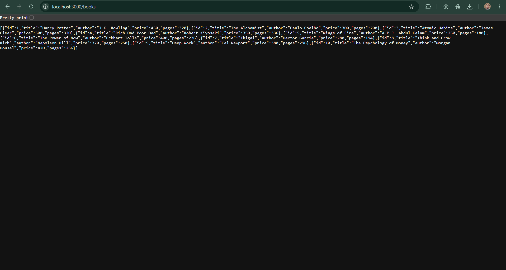

### 3. Search Books – Harry

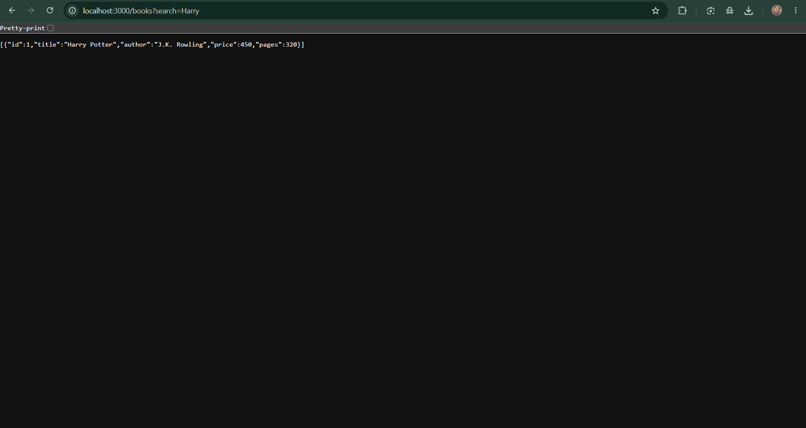

### 4. Search Books – Paulo


### 5. Sort Books – Price Ascending

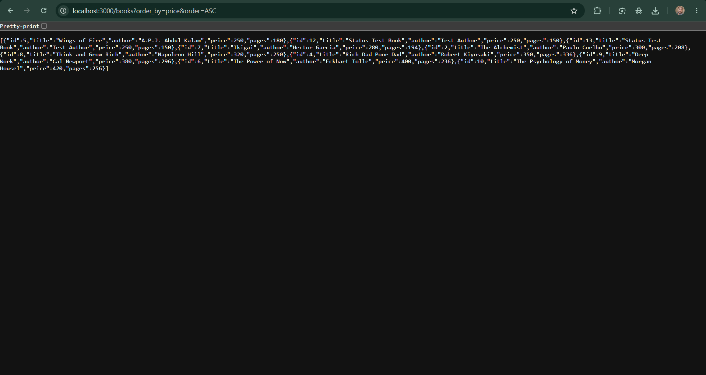

### 6. Sort Books – Price Descending

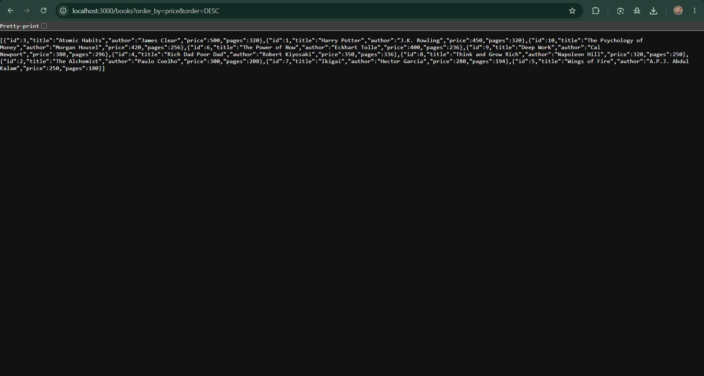

### 7. Pagination – First Page

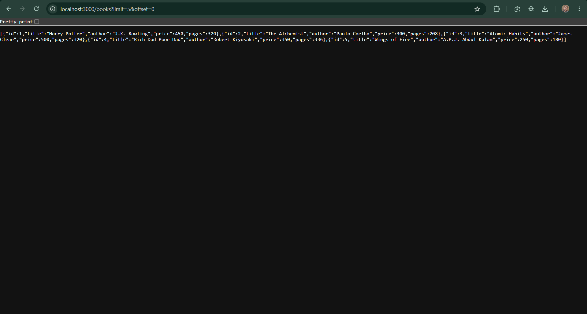

### 8. Pagination – Second Page

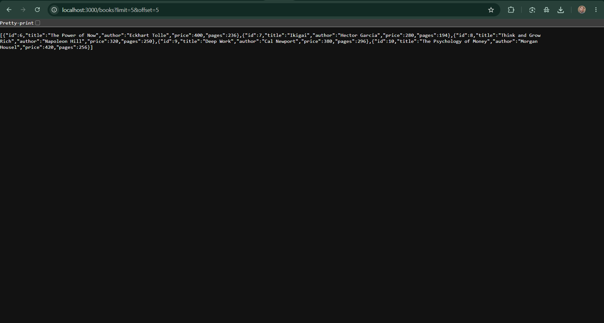

### 9. Minimum Price Filter

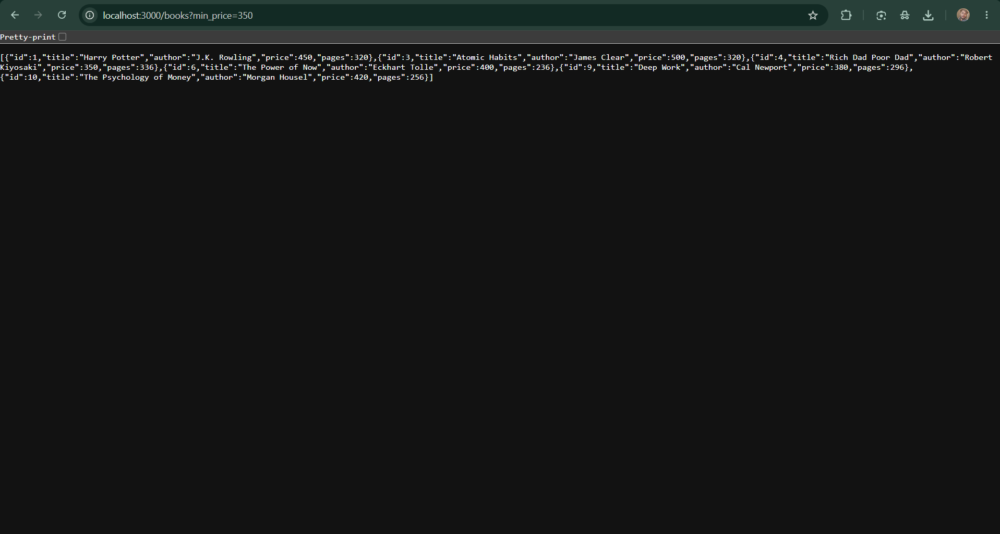

### 10. Maximum Price Filter

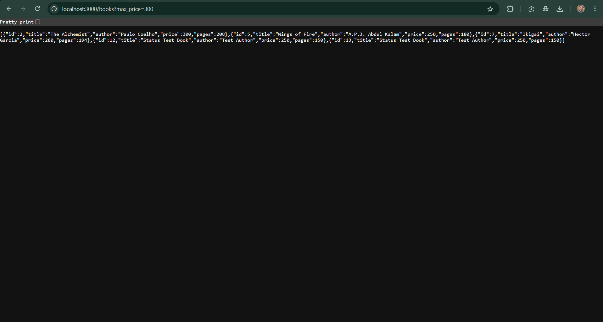

### 11. Price Range Filter

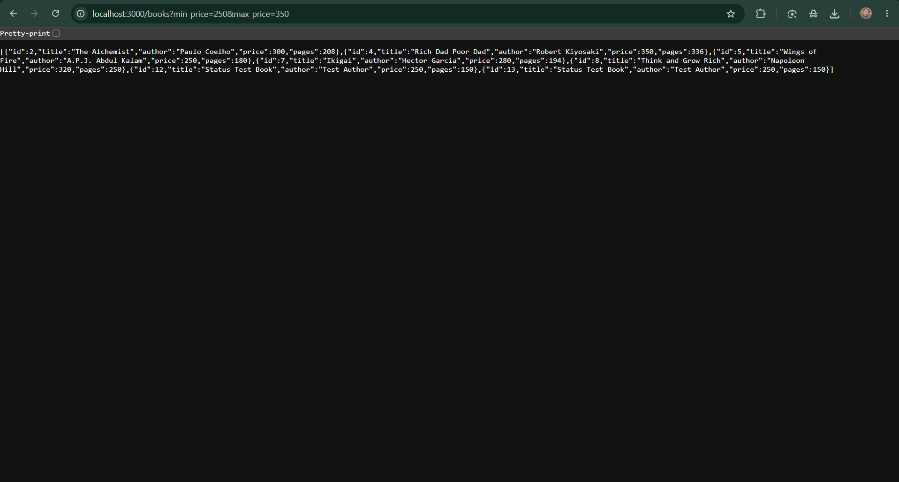

### 12. Invalid Limit Validation

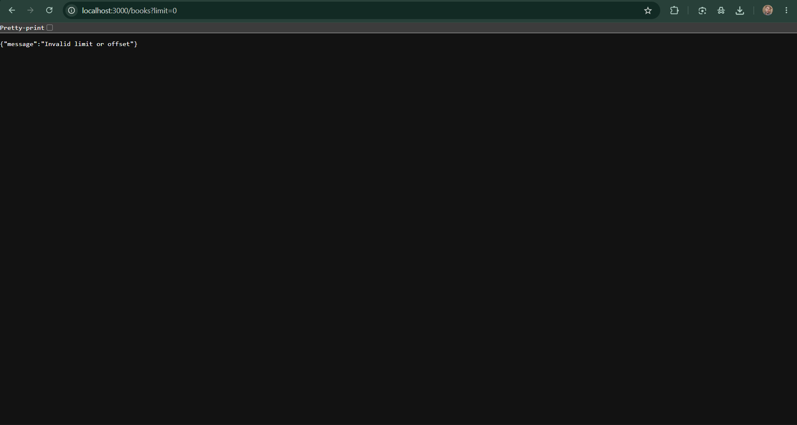

### 13. Invalid Sorting Column

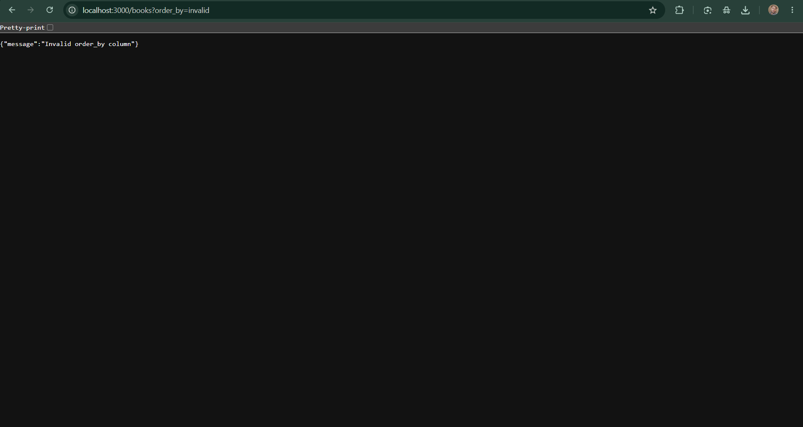

### 14. Invalid Sorting Direction

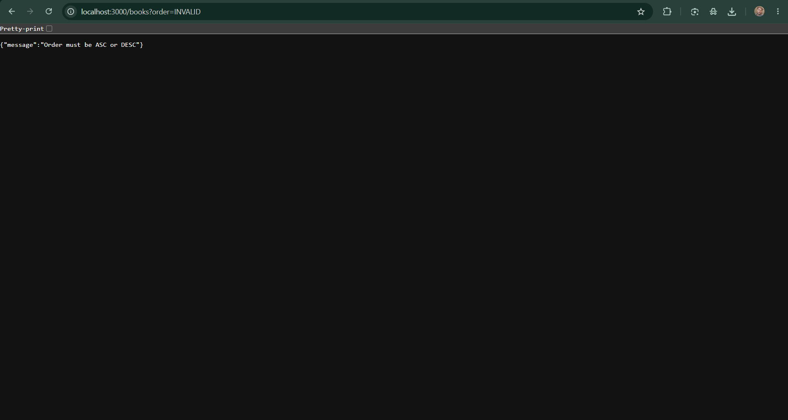

### 15. Invalid Price Range

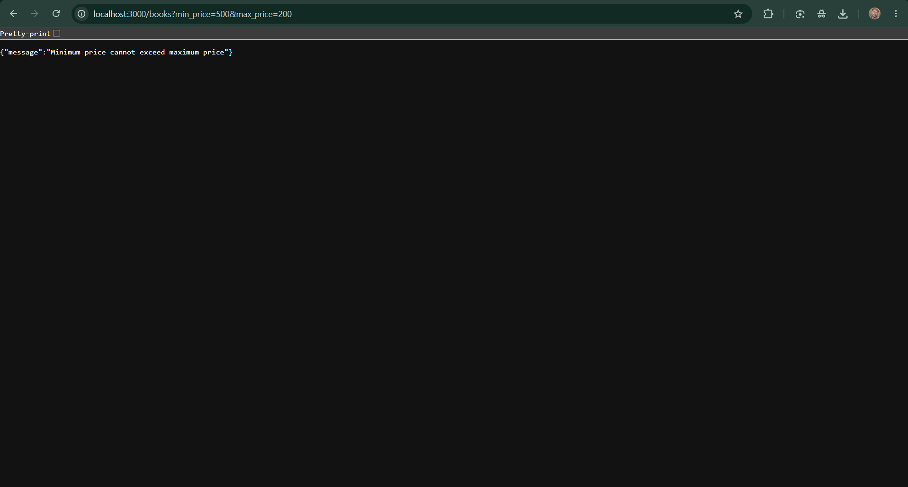

## 🚀 Live Deployment

The Book Management REST API is deployed on Render and available online.

**Live API URL:**  
https://backend-lab-3-book-api.onrender.com/

### API Endpoints

| Method | Endpoint | Description |
|---|---|---|
| GET | `/` | Check API server status |
| GET | `/books` | Retrieve all books |
| GET | `/books/:bookId` | Retrieve a specific book by ID |

### Live API Links

- **Home API:** https://backend-lab-3-book-api.onrender.com/
- **Get All Books:** https://backend-lab-3-book-api.onrender.com/books
- **Get Book by ID:** https://backend-lab-3-book-api.onrender.com/books/1

**Deployment Platform:** Render  


## Conclusion

In this lab, I developed a Book Management REST API using Node.js, Express.js and SQLite. I implemented CRUD operations, searching, sorting, pagination and price filtering. I also learned how to validate user inputs and handle different HTTP status codes. This practical exercise helped me understand REST API development and backend debugging.